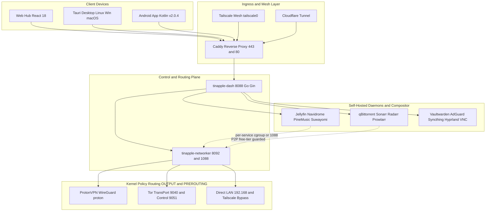

# tinapple

Turnkey **self-hosted homelab OS and home server appliance platform** engineered for bare-metal home servers, repurposed laptops, and mini-PCs. Built on Arch Linux and CachyOS performance packages with a Go control plane (`tinapple-dash`), React web dashboard (`tinapple-hub`), pure native Kotlin Android app (`tinapple-android` v2.0.4), and kernel WireGuard/Tor split-tunneling (`tinapple-networker`).

[](https://github.com/imyash0722/tinapple/releases/latest)
[](https://github.com/imyash0722/tinapple)
[](LICENSE)

---

## Table of Contents

1. [Overview](#1-overview)
2. [Key Capabilities](#2-key-capabilities)
3. [System Architecture and Diagrams](#3-system-architecture-and-diagrams)
4. [Integrated Homelab Services and Port Matrix](#4-integrated-homelab-services-and-port-matrix)
5. [Appliance Packs & Stacks System](#5-appliance-packs--stacks-system)
6. [Hardware Specifications and Power Abstraction](#6-hardware-specifications-and-power-abstraction)
7. [Installation and First-Boot Provisioning](#7-installation-and-first-boot-provisioning)
8. [Networking, Remote Access, and Split-Tunneling](#8-networking-remote-access-and-split-tunneling)
9. [Storage Layout and Multi-User Setup](#9-storage-layout-and-multi-user-setup)
10. [Suwayomi Manga Server Integration](#10-suwayomi-manga-server-integration)
11. [Media Automation & Seerr Stack Orchestrator](#11-media-automation--seerr-stack-orchestrator)
12. [System Updates, Pacman Hooks, and Hot-Deployment](#12-system-updates-pacman-hooks-and-hot-deployment)
13. [Native Client Applications & Multi-Platform Releases](#13-native-client-applications--multi-platform-releases)
14. [Interactive Online Guides & Comprehensive Manual](#14-interactive-online-guides--comprehensive-manual)
15. [Dynamic Wallpaper Gallery & Atmosphere Theming](#15-dynamic-wallpaper-gallery--atmosphere-theming)
16. [Service Management and Command Reference](#16-service-management-and-command-reference)
17. [Troubleshooting and Diagnostic Runbook](#17-troubleshooting-and-diagnostic-runbook)
18. [Repository Directory Structure](#18-repository-directory-structure)
19. [License](#19-license)

---

## 1. Overview

tinapple transforms standard commodity x86_64 computer hardware or retired laptop systems into an appliance-grade home server. Unlike general-purpose Linux server distributions that require manual package management, disparate configuration files, and custom shell scripting, tinapple delivers a unified appliance experience:

- **Web-First Control Plane**: Real-time system monitoring, hardware power profiles, systemd service lifecycle control, and service storefront.
- **Declarative System State**: The entire state of installed daemons, hardware controls, user preferences, and network interfaces is defined in `/etc/tinapple/tinapple.json`.
- **Zero-Downtime Hot Deployments**: Appliance dashboard, API binaries, and configuration templates can be updated and hot-reloaded without full operating system reinstalls or system reboots.
- **Hardware Lifecycle Management**: First-class support for repurposed laptops, including hardware battery charge limits (stopping charge at 80% to prevent cell swelling), ACPI clamshell mode (preventing sleep on lid closure), and thermal profile governors.
- **Secure Encrypted Mesh Access**: Native integration with Caddy and Tailscale to automatically provision trusted Let's Encrypt HTTPS certificates for the dashboard, Web Crypto API vaults, and remote media streaming.

---

## 2. Key Capabilities

- **Kernel and Compiler Optimizations**: Uses CachyOS kernel patchsets (`linux-lts` / BORE scheduler, BBRv3 congestion control) and `x86-64-v3` optimized packages.
- **Unified Reverse Proxy & Encrypted Tunnels**: Caddy terminating Let's Encrypt HTTPS certificates over Tailscale (`:443`) paired with Cloudflare Tunnel ingress (`tinapple-cloudflared`) so the dashboard stays reachable across symmetric NAT.
- **Kernel Split-Tunneling (`tinapple-networker`)**: Routes individual systemd services, the Wi-Fi hotspot AP (`wlp0s20u1`), or Tailscale Exit Node traffic through **ProtonVPN WireGuard** or **Tor transparent circuits** (`TransPort :9040` / `ControlPort :9051` `NEWNYM`), with strict mutual exclusion (`HTTP 409`), P2P Free-tier warnings, and automatic LAN/Tailscale bypass.
- **Integrated Self-Hosted Suite**: Pre-configured Jellyfin (movies/shows), Navidrome + PineMusic (music streaming & lossless queue), Suwayomi (manga server on Java 27), Vaultwarden (password vault), qBittorrent + Servarr stack, AdGuard Home, Syncthing, CouchDB (Obsidian LiveSync), and headless Hyprland + wayvnc (`:5900`) remote desktop.
- **Cross-Platform Clients**: Web dashboard (`tinapple-hub`), Tauri desktop apps (Linux, Windows, macOS), and pure native Kotlin Jetpack Compose Android companion (`tinapple-android` v2.0.4).

---

## 3. System Architecture and Diagrams

The tinapple self-hosted platform separates edge ingress, control plane management, kernel VPN/Tor split-tunneling, hardware power management, and service daemons into distinct layers:

### ASCII System Architecture

```text
+-------------------------------------------------------------------------------+
|                               Client Layer                                    |
|  Web Browser (HTTPS)  |  Tauri Desktop Apps  |  tinapple-android (v2.0.4 APK) |
|  - Homarr 2D Canvas   |  - Local Web Bundle  |  - Jetpack Compose + Matugen   |
|  - Proton & Tor Page  |  - Cross-Platform    |  - Kotlin SSH/PTY & TV/VNC     |
+---------------------------------------+---------------------------------------+
                                        |
                                        v
+-------------------------------------------------------------------------------+
|                      Edge Ingress & Encrypted Mesh                            |
|  - Caddy (:443 TLS / :80 -> HTTPS)    - Tailscale Mesh (tailscale0 / :443)    |
|  - Cloudflare Tunnel (cloudflared)    - Vaultwarden HTTPS Reverse Proxy (:8000)|
+---------------------------------------+---------------------------------------+
                                        |
          +-----------------------------+-----------------------------+
          |                                                           |
          v                                                           v
+--------------------------------------------+  +-------------------------------+
|       Control Plane: tinapple-dash (:8088) |  | tinapple-networker (:8092)    |
|  - Go (Gin) REST API & SSE Telemetry       |  | - WireGuard (`proton`) Tunnel |
|  - React 18 Frontend Bundle (tinapple-hub) |  | - Tor :9040 TransPort / :9051 |
|  - `/api/v1/networker/*` Reverse Proxy     |->| - Smart Proxy (:1088)         |
|  - PTY WebSockets, App Store & /suwayomi   |  | - iptables-nft OUTPUT & PRE   |
+--------------------------------------------+  +---------------+---------------+
          |                                                     |
          +--------------------------+--------------------------+
                                     |
          +--------------------------+--------------------------+
          |                                                     |
          v                                                     v
+--------------------------------------------+  +-------------------------------+
|     Host Reliability & Compositor Layer    |  |   Homelab Service Daemons     |
|  - tinapple-hw (80% Battery, Clamshell)    |  |  Jellyfin :8096 | PineMusic   |
|  - tinapple-wifi-watchdog (wl + IN regdom) |  |  Navidrome :4533| Suwayomi    |
|  - Hyprland HEADLESS-1 + wayvnc (:5900)    |  |  Vaultwarden    | qBittorrent |
|  - tinapple-config-generator               |  |  Sonarr/Radarr  | AdGuard/Tor |
+--------------------------------------------+  +-------------------------------+
```

### Interactive Topology & Split-Tunneling Flow



### Core Components

- **`tinapple-dash`**: Go (Gin) appliance backend (`tinapple-dash.service` on port `:8088`). Manages system telemetry, systemd lifecycles, log streams, Chaddy Store app packs, PTY WebSocket terminals, Suwayomi/Jellyfin/Navidrome widgets, `/download/apk` distribution, and proxies `/api/v1/networker/*`.
- **`tinapple-networker`**: Standalone Go kernel split-tunneling daemon (`tinapple-networker.service`, `:8092` HTTP control API, `:1088` cgroup-aware smart proxy). Orchestrates ProtonVPN WireGuard profiles via `wg setconf` (multi-`.conf` switching without breaking host DNS), Tor transparent circuits (`NEWNYM`), Hotspot & Tailscale Exit Node routing, and mutual exclusion (`Direct` | `ProtonVPN` | `Tor`).
- **`tinapple-hub`**: Single-page control UI built with React 18, TypeScript, Tailwind CSS, Lucide icons, and Framer Motion, compiled to `/usr/share/tinapple-dash/web/dist`. Includes the draggable 2D Homarr canvas and the dedicated **Proton & Tor** split-tunneling page.
- **`tinapple-android`**: Pure native Android companion (`org.tinapple.hub`, v2.0.4, `versionCode 8`) written in Kotlin 2.0.21 with Jetpack Compose Material 3, Matugen wallpaper theming, interactive SSH/PTY terminal, media shelves, and a dedicated ProtonVPN & Tor split-tunneling screen.
- **`tinapple-hw` & `tinapple-wifi-watchdog`**: Hardware power/ACPI daemon (80% battery ceiling, lid-close clamshell operation) paired with a multi-level Broadcom/iwlwifi link recovery watchdog (`IN` regdom + PCIe/module recovery).
- **`Hyprland + wayvnc` (`tinapple-hyprland.service`)**: Headless Wayland compositor spawning a virtual `HEADLESS-1` 1080p display and `wayvnc` RFB 3.8 remote desktop server on port `:5900`.
- **`tinapple-config-generator`**: Renders service manifests (`/etc/tinapple/tinapple.json`) into native Caddy, Navidrome, qBittorrent, and systemd configurations.

---

## 4. Integrated Homelab Services and Port Matrix

tinapple packages and manages a comprehensive suite of homelab services. Below is the network port reference:

| Service | Binary / Package | Systemd Unit | Internal Port | Default Access Path | Function |
|---------|------------------|--------------|---------------|---------------------|----------|
| Tinapple Web Hub | `tinapple-dash` | `tinapple-dash.service` | 8088 | `https://<server>:443/` | Appliance control plane, REST API, and widget dashboard |
| Tinapple Networker | `tinapple-networker` | `tinapple-networker.service` | 8092 / 1088 | `/api/v1/networker/*` | Kernel split-tunneling orchestrator (WireGuard ProtonVPN & Tor proxy) |
| Hyprland Remote Desktop | `Hyprland` + `wayvnc` | `tinapple-hyprland.service` | 5900 | `vnc://<server>:5900` | Headless 1080p Wayland desktop + RFB 3.8 VNC screenshare |
| Vaultwarden | `vaultwarden` | `vaultwarden.service` | 8001 (proxied to 8000) | `https://<server>:8000/` | Bitwarden-compatible password vault (Web Crypto API) |
| Suwayomi Manga | `suwayomi-server-bin` | `suwayomi-server.service` | 4567 | `http://<server>:4567/suwayomi/` | Tachiyomi/Mihon extension server and manga reader (Java 27) |
| Jellyfin | `jellyfin-server` | `jellyfin.service` | 8096 | `http://<server>:8096/` | Media streaming for movies, shows, and audiobooks |
| Navidrome | `navidrome` | `navidrome.service` | 4533 | `http://<server>:4533/` | Subsonic-compatible personal music streaming |
| PineMusic | `pinemusic` | `pinemusic.service` | 8090 | `https://<server>/pinemusic/` | Lossless zero-auth music requester and queue manager for Navidrome |
| qBittorrent | `qbittorrent-nox` | `qbittorrent-nox.service` | 8080 | `http://<server>:8080/` | Headless BitTorrent client with remote WebUI |
| Pinchflat | `pinchflat` | `pinchflat.service` | 8945 | `http://<server>:8945/` | Automated YouTube channel and playlist manager for Jellyfin |
| AdGuard Home | `adguardhome` | `adguardhome.service` | 3000 / 53 | `http://<server>:3000/` | Network-wide DNS sinkhole, privacy filter, and ad-blocker |
| Syncthing | `syncthing` | `syncthing@tinapple.service` | 8384 | `http://<server>:8384/` | Continuous peer-to-peer decentralized file sync |
| FileBrowser | `filebrowser` | `filebrowser.service` | 8081 | `http://<server>:8081/` | Web-based file manager and browser |
| Tor Daemon | `tor` | `tor.service` | 9040 / 9050 / 9051 | Managed by `tinapple-networker` | Transparent onion proxy (`TransPort`), SOCKS5, and circuit control |
| Proton VPN (WireGuard) | `tinapple-networker` (`wg`) | `tinapple-networker.service` | 51820 (WG) | `?tab=networker` | Policy-routed WireGuard exit tunnel (`proton` interface) |
| Sonarr | `sonarr-bin` | `sonarr.service` | 8989 | `http://<server>:8989/` | TV series automation and download manager |
| Radarr | `radarr-bin` | `radarr.service` | 7878 | `http://<server>:7878/` | Movie automation and download manager |
| Prowlarr | `prowlarr-bin` | `prowlarr.service` | 9696 | `http://<server>:9696/` | Torrent indexer and Usenet proxy aggregator |
| Bazarr | `bazarr` | `bazarr.service` | 6767 | `http://<server>:6767/` | Automated subtitle downloader for Sonarr/Radarr |
| Jellyseerr | `seerr` | `seerr.service` | 5055 | `http://<server>:5055/` | Request management and media discovery portal |
| CouchDB | `couchdb` | `couchdb.service` | 5984 | `http://<server>:5984/` | Database backend for Obsidian LiveSync notes |
| SyncYomi | `syncyomi` | `syncyomi.service` | 8282 | `http://<server>:8282/` | Manga reading progress synchronization bridge |
| Minecraft PaperMC | `minecraft` | `minecraft.service` | 25565 | `<server>:25565` | High-tickrate gaming appliance with Aikar GC |
| Playit Anycast | `playit` | `playit.service` | Dynamic | Global Anycast Tunnel | Public domain tunnel for servers without port forwarding |
| Beeper Matrix Bridges | `bbctl` | `bbctl.service` | Dynamic | Matrix Bridges | Self-hosted bridges for WhatsApp, Signal, Discord, etc. |

---

## 5. Appliance Packs & Stacks System

Tinapple delivers cohesive homelab experiences through pre-configured **Appliance Packs**. Instead of manually configuring complex inter-service dependencies, ports, and API tokens across disparate projects, each pack provides 1-click batch installation and automated orchestrator linking:

| Pack Name | Included Daemons | Badge | Core Highlights |
|-----------|------------------|-------|-----------------|
| **Ultimate Streaming & Servarr Stack** | `jellyfin`, `seerr`, `radarr`, `sonarr`, `prowlarr`, `bazarr`, `qbittorrent`, `pinchflat` | `STREAMING & MEDIA` | Zero-touch 4K/1080p media cloud: automated root libraries in `/srv/media`, qBittorrent authenticated API linking, Prowlarr trackers auto-synced, Bazarr multi-language subtitle fetching, Jellyseerr discovery, and Pinchflat YouTube channel manager with Jellyfin NFO tags. |
| **Manga Infinite Library (Suwayomi + Tsumiru)** | `suwayomi` | `MANGA & COMICS` | 1,000+ Keiyoushi source extensions enabled, local storage in `/srv/media/manga`, Suwayomi WebUI for desktop, and direct Suwayomi-Tsumiru native mobile client with zero-overhead server synchronization. |
| **Manga & Mihon Sync Bridge (Suwayomi + SyncYomi)** | `suwayomi`, `syncyomi` | `MIHON & SYNC` | Suwayomi manga engine paired with SyncYomi cross-device synchronization bridge (:8282) for external standalone readers (Mihon, TachiyomiJ2K, and Kuukiyomi). |
| **Mesh Privacy & Perimeter Shield** | `tailscale`, `adguard`, `protonvpn`, `tor` | `SECURITY & MESH` | Zero-trust WireGuard mesh networking, AdGuard Home DNS-over-HTTPS & ad/tracker blocking (:3000), Tor anonymous SOCKS5 onion proxy (:9050), and Proton VPN high-speed egress encryption. |
| **Audiophile Music Cloud & Downloader** | `navidrome`, `pinemusic`, `pinchflat` | `MUSIC & AUDIO` | Lossless Subsonic/Airsonic streaming server for Symfonium, Feishin, and Substreamer, paired with PineMusic for zero-auth multi-platform lossless music requests & queue orchestration, and Pinchflat for automated archiving of YouTube Music feeds directly into `/srv/media/music`. |
| **Cloud Vault & Resilient Backups** | `vaultwarden`, `syncthing`, `filebrowser` | `VAULT & SYNC` | Bitwarden-compatible password vault with Web Crypto API, Syncthing peer-to-peer real-time file synchronization across mobile and desktop devices, and FileBrowser Quantum web file explorer. |
| **Second Brain & Knowledge Base** | `couchdb`, `filebrowser` | `KNOWLEDGE & NOTES` | Real-time end-to-end encrypted database sync for Obsidian LiveSync across iOS, Android, and PC with CORS enabled (:5984), paired with FileBrowser for markdown search and document storage. |
| **Gaming Appliance & Anycast Tunnel** | `minecraft`, `playit` | `GAMING & CLOUD` | PaperMC high-performance Minecraft server (:25565) with Aikar's tuned JVM GC memory optimization flags, paired with Playit.gg Anycast agent providing public player join domains without port forwarding. |

### 1-Click Pack Installation & Auto-Configuration
In the Tinapple Web Hub Store tab, toggle **"Packs & Stacks"** to view live cards. Clicking **"Install Full Pack"** or **"Auto-Configure Stack"** triggers the backend deployment pipeline with live output streamed directly to the built-in terminal.

---

## 6. Hardware Specifications and Power Abstraction

### Minimum Requirements

- **Processor**: 64-bit x86_64 CPU (Intel 4th Generation Core i3/i5/i7 or AMD Zen architecture and newer).
- **RAM**: 4 GB minimum (8 GB or more recommended for Jellyfin transcoding and parallel download extraction).
- **Primary Storage**: 32 GB SSD or NVMe for system root (`/`).
- **Data Storage**: Dedicated internal or USB storage drive mounted at `/home/storage` or `/mnt/storage`.
- **Network Interface**: Gigabit Ethernet (recommended) or 802.11ac/ax Wi-Fi adapter.

### Laptop Hardware Optimization (`tinapple-hw`)

When deploying tinapple on repurposed laptop hardware, the hardware layer activates three protections:

1. **Battery Health Preservation**:
   Standard laptops kept plugged into mains power degrade quickly due to prolonged 100% state-of-charge. The hardware subsystem automatically writes to sysfs kernel power nodes:
   ```bash
   echo 80 > /sys/class/power_supply/BAT0/charge_control_limit_max
   ```
   This caps charging at 80%, extending cell longevity and preventing battery swelling.

2. **Clamshell Operation**:
   Standard systemd configurations trigger suspend when the laptop lid is closed. tinapple sets the following in `/etc/systemd/logind.conf.d/clamshell.conf`:
   ```ini
   [Login]
   HandleLidSwitch=ignore
   HandleLidSwitchExternalPower=ignore
   HandleLidSwitchDocked=ignore
   LidSwitchIgnoreInhibited=no
   ```
   This allows the laptop to operate 24/7 with the screen closed without overheating or sleeping.

3. **Thermal and Fan Governors**:
   Profiles can be changed dynamically via the dashboard or CLI:
   - `quiet`: Caps maximum CPU boost frequencies to keep fans silent.
   - `balanced`: Default mode balancing acoustic profile and burst performance.
   - `performance`: Maximum governor clock limits and active cooling for media transcoding and archive extractions.

---

## 7. Installation and First-Boot Provisioning

### Method A: Clean Installation from ISO

1. Download or build the latest `tinapple-installer.iso`.
2. Write the ISO to a USB flash drive (minimum 4 GB):
   ```bash
   sudo dd if=tinapple-installer.iso of=/dev/sdX bs=4M status=progress oflag=sync
   ```
3. Boot the target machine in UEFI mode.
4. The installation wizard will launch automatically.
5. Select the target disk drive, desired filesystem (Btrfs with subvolumes or Ext4), hostname, and administrator password.
6. The installer formats partitions, bootstraps the base operating system using pacstrap, and configures the bootloader (Limine or systemd-boot).
7. Remove the USB installation drive and reboot.

### Method B: In-Place Conversion on Arch Linux / CachyOS

If you already have a functional minimal Arch Linux or CachyOS installation:

1. Clone the repository:
   ```bash
   git clone https://github.com/imyash0722/tinapple.git /tmp/tinapple
   cd /tmp/tinapple
   ```
2. Run the deployment script targeting localhost:
   ```bash
   ./scripts/deploy-server.sh 127.0.0.1
   ```
3. Enable and start the system daemon:
   ```bash
   sudo systemctl enable --now tinapple-dash.service
   sudo systemctl enable --now caddy.service
   ```

### First-Boot Configuration (`tinapple-firstboot`)

On first system start, `tinapple-firstboot.service` executes to:
- Generate unique machine IDs and SSH host keys.
- Write the default system configuration manifest to `/etc/tinapple/tinapple.json`.
- Configure the storage directory structure in `/home/storage`.
- Start the Caddy reverse proxy and `tinapple-dash` daemon.

---

## 8. Networking, Remote Access, and Split-Tunneling

tinapple uses Caddy as its reverse proxy combined with Tailscale to provide automated, zero-configuration TLS certificates without opening external router ports or setting up dynamic DNS.

### Caddy Reverse Proxy Architecture

The active Caddy configuration is located at `/etc/tinapple/Caddyfile` and tracked in the repository at `configs/caddy/Caddyfile`:

```caddy
{
    admin "unix//run/caddy/admin.socket"
}

# Tailscale HTTPS domain (Automatic Let's Encrypt Certificate)
tinapple-server.tail3dee69.ts.net {
    tls {
        get_certificate tailscale
    }
    reverse_proxy localhost:8088
}

# Vaultwarden on Port 8000 (Requires HTTPS for Web Crypto API)
tinapple-server.tail3dee69.ts.net:8000 {
    tls {
        get_certificate tailscale
    }
    reverse_proxy localhost:8001
}

# Local Network LAN Access with Internal CA Fallback
192.168.1.17, 100.67.207.60, tinapple-server, localhost {
    tls internal
    reverse_proxy localhost:8088
}

192.168.1.17:8000, 100.67.207.60:8000, tinapple-server:8000, localhost:8000 {
    tls internal
    reverse_proxy localhost:8001
}
```

### Tailscale Configuration

1. Authenticate Tailscale on the server:
   ```bash
   sudo tailscale up --operator=tinapple
   ```
2. Verify the Tailscale machine name and IP address:
   ```bash
   tailscale status
   ```
3. Enable HTTPS certificate generation in your Tailscale administration console under DNS preferences (MagicDNS and HTTPS Certificates).
4. Reload Caddy to obtain and bind certificates:
   ```bash
   sudo systemctl reload caddy.service
   ```
5. Test connectivity over HTTPS:
   ```bash
   curl -sI https://tinapple-server.<your-tailnet>.ts.net/
   ```
   The server will return `HTTP/2 200` with a certificate signed by Let's Encrypt.

### Kernel Split-Tunneling (`tinapple-networker`)

Outbound traffic routing is managed by `tinapple-networker.service` (`:8092` HTTP API, `:1088` smart outbound proxy) and controlled from the **Proton & Tor** page (`?tab=networker` on web, **ProtonVPN & Tor Routing** tile in the Android app):

- **Mutually Exclusive Modes**: Every service, Hotspot AP (`wlp0s20u1`), or Tailscale Exit Node (`tailscale0`) runs in one of three states: `direct`, `protonvpn`, or `tor`. Concurrent `protonvpn` + `tor` assignments are rejected (`HTTP 409 Conflict`).
- **ProtonVPN Multi-Config Management**: Parses WireGuard `.conf` profiles, strips conflicting IPv6/DNS resolvers via `wg setconf proton`, and supports uploading custom configs (`+ Add more`) with country and Free-tier metadata detection.
- **Tor Transparent Proxy**: Routes marked targets to Tor `TransPort` (`:9040`) and `DNSPort` (`:5353`), resolves live exit country/city, and rotates circuits via `ControlPort` (`:9051` `SIGNAL NEWNYM`).
- **LAN & Tailscale Bypass + P2P Warnings**: Hotspot and Exit Node chains preserve RFC1918 LAN (`192.168.0.0/16`, `10.0.0.0/8`), localhost, and Tailscale (`100.64.0.0/10`) access, while surfacing Free-tier P2P blocking warnings on torrenting/sync services and Exit Node.

---

## 9. Storage Layout and Multi-User Setup

### Directory Hierarchy

All shared homelab storage is consolidated under `/home/storage`:

```
/home/storage/
├── Music/               # Shared / guest audio library
├── TinMusic/            # Administrator personal audio collection
├── Videos/              # Jellyfin movie and television library
│   ├── Movies/
│   └── TV/
├── Downloads/           # Default download directory
│   ├── Complete/
│   └── Incomplete/
├── Manga/               # Suwayomi local storage and downloaded chapters
└── Backups/             # System manifest and database snapshots
```

Ensure correct filesystem ownership and read/write group permissions:
```bash
sudo chown -R tinapple:tinapple /home/storage
sudo chmod -R 775 /home/storage
```

### Multi-User Music Streaming (Navidrome)

Navidrome provides Subsonic-compatible streaming for applications such as Symfonium, Amperfy, and Feishin.

To configure distinct music folders for separate user accounts (for example, keeping an administrator library private while offering a standard library to guests):

1. **User Account Separation**:
   - Administrator Account: `tin` (Full administrative privileges, library path pointed to `/home/storage/TinMusic`).
   - Guest / Friend Account: `icekimi` (Standard privileges, library path pointed to `/home/storage/Music`).
2. **Navidrome Service Configuration** (`/etc/navidrome/navidrome.toml`):
   ```toml
   MusicFolder = "/home/storage"
   ScanSchedule = "@every 30m"
   LogLevel = "INFO"
   Port = 4533
   Address = "0.0.0.0"
   DefaultDownsamplingFormat = "opus"
   ```
3. Restart Navidrome to apply updates:
   ```bash
   sudo systemctl restart navidrome.service
   ```

---

## 10. Suwayomi Manga Server Integration

Suwayomi Server (v2.4+) runs on port 4567, acting as an independent self-hosted manga backend compatible with the Tachiyomi, Mihon, and Keiyoushi source extension ecosystems.

### Integration Architecture

- **GraphQL Engine**: Communication between `tinapple-dash` and Suwayomi uses Suwayomi's native GraphQL interface at `http://127.0.0.1:4567/suwayomi/api/graphql` (fallback `/api/graphql`), running on Java 27 OpenJDK while keeping Java 17 as system default for Minecraft.
- **Deduplication and Recency Logic**:
  - *Library Tab (`Library (241)`)*: Queries `mangas(condition: { inLibrary: true }, order: [{by: IN_LIBRARY_AT, byType: DESC_NULLS_LAST}])` to present recently added titles with unread chapter count badges.
  - *History Tab (`History`)*: Queries read chapters ordered by `LAST_READ_AT DESC` and deduplicates by manga series ID. Each manga appears once, displaying the exact last chapter read.
  - *Updates Tab (`Updates`)*: Queries unread chapters ordered by `UPLOAD_DATE DESC` and deduplicates by series ID. Each title appears once, indicating the newest chapter available.
- **WebP Thumbnail Proxy**: Suwayomi serves cover images with arbitrary headers. `tinapple-dash` proxies all thumbnail requests via `/api/v1/manga/:id/thumbnail`, sniffing byte headers, enforcing proper `Content-Type: image/webp`, and adding HTTP cache headers (`Cache-Control: public, max-age=86400`).
- **Direct Title Navigation**: Clicking any manga card in the dashboard opens directly into that manga's title and chapter overview page in Suwayomi (`http://<server>:4567/manga/<id>`).

### Adding Extensions via Keiyoushi

To install manga source extensions in Suwayomi:
1. Open Suwayomi WebUI at `http://<server>:4567/`.
2. Navigate to **Settings** -> **Browse** -> **Extension Repositories**.
3. Add the Keiyoushi repository URL:
   ```
   https://raw.githubusercontent.com/keiyoushi/extensions/repo/index.min.json
   ```
4. Navigate to **Extensions**, search for your desired sources (e.g. MangaDex, Asura Scans, MangaFire), and click **Install**.

---

## 11. Media Automation & Seerr Stack Orchestrator

Tinapple integrates a headless zero-touch media automation pipeline linking Jellyfin, Jellyseerr, Radarr, Sonarr, Prowlarr, Bazarr, and qBittorrent.

### Automated Orchestration Script (`tinapple-configure-seerr`)
The pipeline is fully automated via `/usr/local/bin/tinapple-configure-seerr` (source: [`scripts/tinapple-configure-seerr`](scripts/tinapple-configure-seerr)):
1. **Filesystem Hierarchy**: Pre-provisions `/srv/media/{movies,shows,anime,kdrama,music,downloads,downloads/complete,downloads/incomplete,downloads/radarr,downloads/sonarr,youtube,youtube-music,manga}` with group `media` and `2775` (`g+s`) sticky permissions. All daemon users (`jellyfin`, `qbt`, `tinapple`, `seerr`, `bazarr`) are verified in the `media` group. Backward-compatibility symlinks in `~/storage` point to the unified `/srv/media` directory.
2. **qBittorrent WebUI**: Sets credentials (`admin` / `adminadmin`) on port 8080 with default save path `/srv/media/downloads/`, temporary incomplete folder `/srv/media/downloads/incomplete/`, and subnet whitelisting for trusted local and Tailscale networks.
3. **FlareSolverr Anti-Bot Bypass**: Connects FlareSolverr (`:8191`) as an indexer proxy with tag `flaresolverr`, ensuring Cloudflare Turnstile and challenge-protected trackers are solved automatically for indexers.
4. **Radarr & Sonarr Root Folders & Clients**:
   - Configures `/srv/media/movies` in Radarr and links qBittorrent download client with category `radarr`.
   - Configures `/srv/media/shows`, `/srv/media/anime`, and `/srv/media/kdrama` in Sonarr and links qBittorrent download client with category `sonarr`.
5. **Prowlarr Tracker Sync**:
   - Links Radarr and Sonarr applications into Prowlarr with full synchronization (`fullSync`).
   - Automatically synchronizes popular movie and TV indexers: YTS, The Pirate Bay, Torrent Downloads, and Knaben.
   - Automatically synchronizes specialized Anime indexers: Nyaa.si, Anime Tosho, Tokyo Toshokan, SubsPlease, and Shana Project.
   - Automatically covers K-Drama and Asian live action releases via Nyaa.si (East Asian Live Action section), Torrent Downloads, The Pirate Bay, and Knaben.
   - Removes deprecated or non-functional indexers and executes `ApplicationIndexerSync` so indexers instantly populate in Radarr and Sonarr.
6. **Bazarr Subtitles**: Links Radarr and Sonarr API keys in `/var/lib/bazarr/config/config.yaml` for multi-language subtitle fetching across all media libraries.
7. **Jellyfin Media Libraries**: Maps `/srv/media/movies` into Movies, `/srv/media/shows` into Shows, and registers dedicated libraries for Anime (`/srv/media/anime`) and K-Drama (`/srv/media/kdrama`).
8. **Jellyseerr Discovery Portal**: Configures `/var/lib/seerr/settings.json` linking Jellyfin (`127.0.0.1:8096`), Radarr (`/srv/media/movies`), and Sonarr (`/srv/media/shows` and `/srv/media/anime`) for one-click discovery and request automation.

---

## 12. System Updates, Pacman Hooks, and Hot-Deployment

### The Tinapple Pacman Repository Architecture (`[tinapple]`)

Tinapple OS features an official GPG-signed Pacman package repository containing custom appliance daemons, CLI utilities, hardware detection engines, and desktop integration components.

#### 1. Repository Configuration (`/etc/pacman.conf`)
To enable the repository on any Arch-based client or server:

```ini
# /etc/pacman.conf

[tinapple]
SigLevel = Required DatabaseOptional
Include = /etc/pacman.d/tinapple-mirrorlist
```

#### 2. Mirrorlist Definition (`/etc/pacman.d/tinapple-mirrorlist`)
The mirrorlist provides multi-tier redundant endpoints (GitHub CDN & GitHub Pages):

```ini
# /etc/pacman.d/tinapple-mirrorlist
Server = https://raw.githubusercontent.com/imyash0722/tinapple/main/tinapple-repo/repo/$arch
Server = https://imyash0722.github.io/tinapple/$arch
```

#### 3. GPG Keyring & Trust Initialization
The repository is secured with detached GPG signatures verified via pacman:
```bash
# Import and sign the Tinapple release key (ID: 1995D6808AD165B0E86A08D2911A6E2B2CEA57EA)
curl -fsSL https://raw.githubusercontent.com/imyash0722/tinapple/main/tinapple-repo/repo/x86_64/tinapple.gpg | pacman-key --add -
pacman-key --lsign-key 1995D6808AD165B0E86A08D2911A6E2B2CEA57EA
```

#### 4. Available Repository Packages (`pacman -Sl tinapple`)
| Package | Version | Description |
| :--- | :--- | :--- |
| `tinapple-dash` | `0.0.1-1` | Go web control plane, REST API, & WebSocket telemetry daemon |
| `chaddy-store` | `0.0.1-1` | Zero-touch appliance marketplace CLI & package manager |
| `tinapple-base` | `0.0.1-1` | System base meta-package, preset rules & ACPI clamshell inhibitors |
| `tinapple-hw` | `0.0.1-2` | Hardware sensors, battery charge limits (80%), & thermal governor |
| `tinapple-maintenance` | `0.0.1-1` | Snapper Btrfs rollbacks, ALPM pacman hooks & health check daemons |
| `tinapple-mirrorlist` | `20260928-1` | Mirrorlist configuration for `/etc/pacman.d/tinapple-mirrorlist` |
| `tinapple-keyring` | `20260928-1` | GPG keyring for automated pacman trust database population |
| `tinapple-firstboot` | `0.0.1-1` | Interactive TTY1 first-boot provisioning engine |
| `tinapple-nginx` | `0.0.1-1` | Automated Caddy reverse proxy core module & dynamic route refresh |
| `tpm` | `3.1.0-1` | Tmux Plugin Manager package |
| `xrdp` | `0.10.6.1-1` | High-performance remote desktop RDP daemon |

---

### Universal Update Compatibility (`pacman -Syu` & `paru -Syu`)

Tinapple is designed so that standard Arch Linux update commands (`pacman -Syu` or `paru -Syu`) automatically upgrade all core system packages, CachyOS compiler-optimized kernels, Tinapple repository packages, and AUR appliances.

```bash
# Universal update from any terminal or SSH session:
sudo pacman -Syu

# Or with AUR helper (updates both repo and AUR packages):
paru -Syu

# Or using the built-in system alias:
update
```

### Automated ALPM Transaction Hook (`95-tinapple-feature-sync.hook`)
Installed in `/usr/share/libalpm/hooks/` and `/etc/pacman.d/hooks/`, this hook automatically fires at the conclusion of every pacman transaction (`Operation = Upgrade / Install`):

```ini
[Trigger]
Operation = Upgrade
Operation = Install
Type = Package
Target = *

[Action]
Description = Synchronizing Tinapple appliance features, permissions, and stack links...
When = PostTransaction
Exec = /usr/local/bin/tinapple-update --post-transaction
```

Whenever packages are upgraded or installed via `pacman` or `paru`, the hook executes `/usr/local/bin/tinapple-update --post-transaction`, which:
1. **Ensures `paru` AUR helper** is active (or automatically bootstraps `paru-bin` for AUR packages).
2. **Synchronizes `/srv/media` Hierarchy**: Verifies `movies`, `shows`, `music`, `downloads`, `youtube`, and `manga` folders with `2775` permissions and validates that daemon users (`jellyfin`, `qbt`, `navidrome`, `suwayomi`) belong to the `media` group.
3. **Ensures `bbctl`** (Beeper Matrix Chat Bridges manager) is downloaded and executable at `/usr/local/bin/bbctl`.
4. **Executes `tinapple-configure-seerr`**: Automatically links Radarr, Sonarr, Prowlarr, Bazarr, and Jellyseerr without manual API key entry.
5. **Synchronizes Wallpaper Gallery**: Synchronizes native wallpapers from `imyash0722/Wallpapers` to `/usr/share/tinapple-dash/wallpapers`.
6. **Daemon & Proxy Health**: Reloads systemd daemon and verifies `tinapple-dash.service` is healthy on port 8088.

### Dashboard 1-Click Web Update
Clicking the **"Update OS"** button in the dashboard top navigation bar (or mobile bottom bar) initiates `POST /api/v1/system/update`, which executes `/usr/local/bin/tinapple-update` in full mode and streams live terminal logs directly into the web console.

### Hot-Deployment Tool (`deploy-server.sh`)

For live development workstations, tinapple includes an automated hot-deployment tool located at [`scripts/deploy-server.sh`](scripts/deploy-server.sh). It compiles and updates the appliance without requiring an operating system reinstall, without wiping user data, and without system reboots:

```
Developer Workstation                                    tinapple Server
+------------------------------------+                +-------------------------+
| 1. npm run build (tinapple-hub)   |                |                         |
|    -> dist/assets/index-*.js       |                |                         |
|                                    |                |                         |
| 2. go build (tinapple-dash)        |                |                         |
|    -> bin/tinapple-dash            |                |                         |
|                                    |                |                         |
| 3. Stream binary & web assets      | == SSH/SCP ==> | /tmp/tinapple-dash      |
|    via tar archive pipe            |                | /usr/share/.../web/dist |
|                                    |                |                         |
| 4. systemctl restart               |                | systemctl restart       |
|    tinapple-dash.service           |                | tinapple-dash.service   |
+------------------------------------+                +-------------------------+
```

```bash
./scripts/deploy-server.sh 100.67.207.60
```

---

## 13. Native Client Applications & Multi-Platform Releases

Tinapple delivers a native client experience across desktop and mobile platforms, with offline static bundling on desktop/iOS and pure Jetpack Compose UI on Android.

### Client Architecture & Offline Cache Stack

```text
+-----------------------------------------------------------------------------------------+
|                               Tinapple Client Layer                                     |
|                                                                                         |
|  [ Linux AppImage ]  [ Windows EXE ]  [ macOS DMG ]  [ Android APK ]  [ iOS IPA ]      |
+-----------------------------------------------------------------------------------------+
                                           |
                       HTTP / HTTPS REST & WebSockets
              (/api/v1/system, /api/v1/networker/*, /api/v1/terminal/ws)
                                           |
                                           v
+-----------------------------------------------------------------------------------------+
|                 Tinapple Control Plane (:8088) & Networker (:8092)                      |
|  - Dashboard Settings & Layout Persistence (/etc/tinapple/dashboard_layout.json)       |
|  - Real-Time Systemd Management, ProtonVPN WireGuard & Tor Split-Tunneling             |
+-----------------------------------------------------------------------------------------+
```

---

### Available Release Artifacts (`out/releases/` & Dashboard `/download/...`)

All platform release binaries are checksummed (`SHA256SUMS`) and distributed directly from the server dashboard:

| Platform | Format | Release File | Dashboard Download URL |
| :--- | :--- | :--- | :--- |
| **Linux Desktop** | AppImage (x86_64) | `tinapple-desktop-linux-x86_64.AppImage` | `http://<server>:8088/download/desktop` |
| **Linux Portable** | Tarball (.tar.gz) | `tinapple-desktop-linux-x86_64.tar.gz` | `http://<server>:8088/download/releases/tinapple-desktop-linux-x86_64.tar.gz` |
| **Windows Desktop** | Portable EXE | `tinapple-desktop-windows-x64.exe` | `http://<server>:8088/download/windows` |
| **Windows Portable** | ZIP Package | `tinapple-desktop-windows-x64.zip` | `http://<server>:8088/download/releases/tinapple-desktop-windows-x64.zip` |
| **macOS Desktop** | Universal DMG | `tinapple-desktop-macos-universal.dmg` | `http://<server>:8088/download/macos` |
| **Android Companion** | Signed APK | `tinapple-android-client.apk` | `http://<server>:8088/download/android` (or `/download/apk`) |
| **iOS Companion** | IPA Archive | `tinapple-ios-client.ipa` | `http://<server>:8088/download/ios` |
| **Integrity Signatures** | SHA-256 Sums | `SHA256SUMS` | `http://<server>:8088/download/releases/SHA256SUMS` |

---

### 1. Tauri Desktop Client (`tinapple-hub/src-tauri`)

The Tauri desktop client (`org.tinapple.hub`) provides native desktop integration for Linux, Windows, and macOS:

- **Local Asset Serving**: Bundles static production assets directly into the binary (`frontendDist: "../dist"`). All application navigation, modal interactions, and canvas panning run with zero network overhead.
- **Hardware Acceleration**: Automatically leverages native GPU-accelerated WebViews (WebKitGTK on Linux, WebView2 on Windows, WKWebView on macOS).
- **Server Discovery & Dynamic Switching**: Automatically queries local appliance endpoints (`http://100.67.207.60:8088`, `http://192.168.4.1:8088`, or custom user-configured hostnames).

#### Compiling Tauri Desktop Releases Locally:
```bash
# Package all platform releases into out/releases/:
./scripts/build-desktop-releases.sh

# Or build native Tauri binary with cargo:
cd tinapple-hub/src-tauri
cargo build --release
```

#### Automated Cross-Platform CI Releases:
GitHub Actions workflow [`.github/workflows/client-releases.yml`](.github/workflows/client-releases.yml) automatically compiles and publishes native binaries across `ubuntu-22.04`, `windows-latest`, and `macos-latest` upon pushing git tags `v*`.

---

### 2. Pure Native Kotlin Android Companion Client (`tinapple-android`, v2.0.4)

The Android companion app (`org.tinapple.hub`, `versionCode 8`, Kotlin 2.0.21) is built with Jetpack Compose and Material 3:

- **Pure Native Compose Architecture**: 14 MB signed APK (`minSdk 26`, `targetSdk 35`) built for responsive 120Hz scrolling.
- **ProtonVPN & Tor Split-Tunneling Page (`NetworkPrivacyScreen`)**: Clickable **ProtonVPN & Tor Routing** home tile opening master ProtonVPN/Tor controls, WireGuard `.conf` dropdown with SAF file upload (`+ Add more`), live Tor exit country readout, and per-service / Hotspot / Exit Node toggles with P2P Free-tier warnings.
- **Media, Manga & Remote Desktop Widgets**: Suwayomi manga shelf (1-tap launch in Tsumiru), Jellyfin shelf (1-tap launch in Plezy), Navidrome now-playing card, and Hyprland remote desktop card (AVNC 1-tap connect + headless 1080p telemetry).
- **Interactive Kotlin SSH / PTY Terminal**: WebSocket PTY client (`/api/v1/terminal/ws`) with ANSI color parsing and an accessory key bar (`ESC`, `TAB`, sticky `CTRL`/`ALT`, arrows, shell symbols).
- **Matugen Dynamic Theming & Liquid Glass**: Samples server wallpapers into 4 Material 3 color harmonies with live translucency presets.
- **Multi-Endpoint Discovery**: Parallel `/health` probing across LAN, Tailscale mesh, and Tailscale HTTPS domains.

#### Building & Packaging Android APK:
```bash
./scripts/build-desktop-releases.sh
```

#### Installing via ADB:
```bash
# Verify checksum:
sha256sum -c out/releases/tinapple-android-client.apk.sha256

# Fresh install (or if upgrading from an earlier debug build):
adb uninstall org.tinapple.hub || true
adb install -r out/releases/tinapple-android-client.apk
```

> [!IMPORTANT]
> **Android 14 / 15 / 16 / 17 Compatibility & Keystore Signatures:**
> Modern Android enforces strict signature verification and blocks package updates if the signing certificate differs from the installed version (`INSTALL_FAILED_UPDATE_INCOMPATIBLE`). Production builds are signed with APK Signature Schemes v1, v2, and v3 using the permanent Tinapple Release Keystore. If upgrading from an earlier test build, please uninstall the old application before installing the release APK. Ensure "Install unknown apps" permission is granted to your browser or file manager if installing directly from the device.

---

### 3. Client Settings & Canvas Layout Persistence

Tinapple ensures complete bidirectional persistence of dashboard layouts, custom widgets, and appearance preferences across all devices and sessions:

1. **Local Storage First**: Any change made on the canvas (moving widgets, resizing tiles, panning the canvas, zooming, switching themes) is immediately saved to the client's `localStorage` (`tinapple_homarr_canvas_widgets_v6`, `tinapple_theme_settings`).
2. **Server-Side Synchronization**: Layout states are automatically synchronized with the appliance backend:
   - `GET /api/v1/dashboard/layout`: Returns server-saved layout configuration from `/etc/tinapple/dashboard_layout.json`.
   - `POST /api/v1/dashboard/layout`: Debounced server-side persistence of canvas widgets and viewport coordinates.
   - `GET /api/v1/user/settings` & `POST /api/v1/user/settings`: Synchronizes appearance tokens, Matugen dynamic colors, and server URLs across clients.
3. **Multi-Client Consistency**: If a user logs in from a new desktop, tablet, or clean browser install, the canvas layout automatically loads from the server's synchronized state.

---

### 4. Recent Core Platform Enhancements

- **2D Infinite Draggable Canvas**: Replaced rigid column grids with a freeform 3200×2200 2D canvas with smooth left-click drag panning, dynamic zoom, and minimap navigation radar.
- **Dedicated Appliance Widgets**: Users can place compact, dedicated monitoring & control widgets for each individual appliance (Jellyfin, qBittorrent, Suwayomi, Radarr, Sonarr, Prowlarr, Bazarr, Navidrome, etc.) with live state badges, port pills, direct service controls, and WebUI links.
- **Proton VPN & Tor Privacy Exit Node Switchboard**: Dual privacy exit node switches with real-time tunnel detection and high-contrast tactile Matugen toggles.
- **Tailscale Shared Users & RBAC**: Resolves external shared tailnet users (`imyashlinux@gmail.com`) via `tailscale whois` with 1-click admin control elevation and granular service access permissions.
- **Fullpage Web Terminal**: Dedicated fullscreen xterm.js pseudoterminal (`/terminal`) connected via PTY WebSockets with quick diagnostic actions and touch buttons.

---

### 5. Plezy & Suwayomi-Tsumiru Native Media Clients

- **Plezy Desktop Client (Jellyfin Streaming)**: Pre-installed on client desktops at `~/.local/bin/plezy` (`v2.25.0`), embedding `libmpv` for 100% DirectPlay with zero server transcoding load.
- **Suwayomi-Tsumiru (Manga Streaming)**: Hosted locally at `/tsumiru/` with Keiyoushi manga source extensions and continuous chapter caching. Mobile APK available directly at `/download/tsumiru`.

---

## 14. Interactive Online Guides & Comprehensive Manual

Tinapple OS features an integrated, interactive Documentation & Client Setup portal accessible directly via the top navigation bar (`Guides` button) or at dedicated `/guide/<service>` endpoints.

Each guide provides zero-jargon instructions, exact connection URLs (with permanent Tailscale MagicDNS addresses), recommended hardware decoding profiles, and direct download links for desktop and mobile clients.

### Available Online Guides

| Service / Topic | Web Endpoint | Topics Covered |
|-----------------|--------------|----------------|
| **Plezy & Jellyfin** | `/guide/plezy` | Hardware DirectPlay (libmpv), VAAPI/QSV transcoding, multi-channel audio bitstreaming, desktop & mobile setup |
| **Jellyseerr & Servarr** | `/guide/seerr` | Zero-touch movie/show request portal, Prowlarr indexer linking, Bazarr subtitle automation, hardlinks |
| **AdGuard Home** | `/guide/adguard` | Network-wide DNS ad-blocking, home router DHCP configuration, Android Private DNS, Apple profiles |
| **Navidrome Music** | `/guide/navidrome` | Lossless Subsonic audio streaming, Feishin (desktop), Symfonium (Android), Substreamer (iOS) |
| **SyncYomi & Suwayomi** | `/guide/syncyomi` | Centralized reading progress, Mihon & Komikku mobile sync, Keiyoushi extensions, Tsumiru reader |
| **Vaultwarden** | `/guide/vaultwarden` | Zero-knowledge password vault, Bitwarden browser extensions & mobile apps, disabling public signups |
| **Syncthing** | `/guide/syncthing` | Peer-to-peer folder replication, phone camera auto-backup, staggered versioning protection |
| **Obsidian LiveSync** | `/guide/obsidian` | End-to-end encrypted markdown notes sync with self-hosted CouchDB database backend |
| **Beeper Bridges** | `/guide/beeper` | Self-hosted WhatsApp, Signal, Discord Matrix bridges with `bbctl` CLI |
| **Tor Privacy Routing** | `/guide/tor` | SOCKS5 privacy routing, hidden services, Firefox proxy configuration |
| **Tailscale Mesh VPN** | `/guide/ssh` | Zero-config WireGuard mesh remote access, Tailscale SSH, subnet router configuration |

---

## 15. Dynamic Wallpaper Gallery & Atmosphere Theming

Tinapple OS incorporates a dynamic wallpaper switching and theming engine inspired by the Tinarchy architecture, backed by the official [`imyash0722/Wallpapers`](https://github.com/imyash0722/Wallpapers) collection.

### Key Capabilities

1. **Rich Wallpaper Gallery (120+ Curated Themes)**:
   - **Animated Loops (`.mp4`)**: Smooth, high-efficiency looping video backgrounds with muted hardware decoding.
   - **Pixel Art**: Retro nostalgic sceneries, lo-fi aesthetic cities, and rain-soaked alleyways.
   - **Anime & Aesthetic**: Studio Ghibli-style landscapes, cherry blossom shrines, and torii gates.
   - **Nature & Scenery**: Nachi falls, alpine pagoda cities, aurora borealis, and misty mountains.
   - **Sci-Fi & Cyberpunk**: Space horizons, planetary orbits, and futuristic battlestations.
   - **Pineapple Originals**: Golden branded appliance artwork.

2. **Automated Upstream Synchronization**:
   - `scripts/tinapple-update` automatically verifies and synchronizes `/usr/share/tinapple-dash/wallpapers` from `https://github.com/imyash0722/Wallpapers.git`.
   - Any new wallpaper added to the GitHub repository is pulled automatically whenever a system update is triggered.

3. **Dynamic Pywal Color Sampling**:
   - When **"Dynamic Pywal Auto-Color Sampling"** is enabled, selecting any wallpaper samples dominant vibrant midtones using a canvas quantizer and dynamically recolors the portal's primary and secondary accent hues in real time.

4. **1-Click Shuffle & Custom Upload**:
   - **Shuffle**: Instantaneously rolls a random wallpaper from the collection.
   - **Custom Upload**: Drag and drop personal `.jpg`, `.png`, `.webp`, or `.mp4` video files to upload directly to the server and apply immediately.

---

## 16. Service Management and Command Reference

### Service Control Commands

| Task | Command |
|------|---------|
| Check Dashboard Status | `sudo systemctl status tinapple-dash.service` |
| Restart Dashboard | `sudo systemctl restart tinapple-dash.service` |
| Check Split-Tunneling Harness | `sudo systemctl status tinapple-networker.service` |
| Inspect WireGuard & Routes | `wg show proton && curl -s http://127.0.0.1:8092/api/v1/networker/status` |
| Check Hyprland Remote Desktop | `sudo systemctl status tinapple-hyprland.service` |
| Check Wi-Fi Watchdog | `sudo systemctl status tinapple-wifi-watchdog.service` |
| Check Caddy Proxy Status | `sudo systemctl status caddy.service` |
| Reload Caddy Configuration | `sudo systemctl reload caddy.service` |
| Restart Suwayomi Manga Server | `sudo systemctl restart suwayomi-server.service` |
| Restart Jellyfin Media Server | `sudo systemctl restart jellyfin.service` |
| Restart Navidrome Music Server | `sudo systemctl restart navidrome.service` |
| Toggle Tor Anonymity Daemon | `sudo systemctl restart tor.service` (or toggle via dashboard) |
| Check Active Port Listeners | `ss -tulpn` |

### Log Inspection

```bash
# Follow real-time dashboard logs
journalctl -u tinapple-dash.service -f -n 100

# Inspect Caddy TLS and reverse proxy logs
journalctl -u caddy.service -f -n 50

# Inspect Suwayomi Manga Server logs
journalctl -u suwayomi-server.service -f -n 100

# Inspect hardware power daemon logs
journalctl -u tinapple-hw.service -f
```

---

## 17. Troubleshooting and Diagnostic Runbook

### Issue: Vaultwarden Displays Web Crypto API Error

- **Symptom**: Web vault displays error: "This browser requires an HTTPS connection to use the Web Cryptography API."
- **Root Cause**: Vaultwarden was accessed over unencrypted HTTP (port 8000 or 8001). Modern web browsers disable cryptography primitives on insecure origins.
- **Resolution**: Access Vaultwarden exclusively through the Caddy TLS reverse proxy:
  ```
  https://tinapple-server.<your-tailnet>.ts.net:8000/
  ```

### Issue: Suwayomi Manga Shelf Shows Server Offline

- **Symptom**: The manga shelf widget displays "Suwayomi Manga Server Offline".
- **Resolution**:
  1. Verify the Suwayomi systemd unit is active:
     ```bash
     sudo systemctl status suwayomi-server.service
     ```
  2. Test local connectivity to the GraphQL endpoint (requires Java 21+/27 runtime and `/suwayomi` subpath):
     ```bash
     curl -s -X POST http://127.0.0.1:4567/suwayomi/api/graphql \
       -H "Content-Type: application/json" \
       -d '{"query":"{ mangas { totalCount } }"}'
     ```
  3. Ensure Suwayomi is bound to `0.0.0.0:4567` or `127.0.0.1:4567`.

### Issue: Android Installation Fails with INSTALL_FAILED_DEPRECATED_SDK_VERSION

- **Symptom**: ADB install fails on Android 14 / 15 with:
  `INSTALL_FAILED_DEPRECATED_SDK_VERSION: App package must target at least SDK version 24, but found 0`.
- **Root Cause**: The APK manifest was missing the `<uses-sdk>` directive or targeted a legacy API version.
- **Resolution**: Verify [`tinapple-android/app/build.gradle`](tinapple-android/app/build.gradle) specifies `minSdk 26` and `targetSdk 35`. Recompile on a host with the Android SDK via `./gradlew assembleRelease` (or `./scripts/build-desktop-releases.sh`) and reinstall.

### Issue: Battery Does Not Stop Charging at 80%

- **Symptom**: Laptop battery continues charging to 100%.
- **Resolution**:
  Check if your hardware controller supports charge thresholds:
  ```bash
  cat /sys/class/power_supply/BAT0/charge_control_limit_max
  ```
  If the file exists, enforce the threshold manually:
  ```bash
  echo 80 | sudo tee /sys/class/power_supply/BAT0/charge_control_limit_max
  ```
  For ThinkPad devices, the node path may be `charge_control_end_threshold`.

---

## 18. Repository Directory Structure

```text
tinapple/
├── bin/                          # Standalone binary tools
├── chaddy-store/                 # Appliance marketplace & pack installer
├── configs/                      # Caddy & service configuration templates
├── docs/                         # Architecture specs & supplementary docs
├── out/releases/                 # Compiled client packages (APK, AppImage, DMG, EXE, IPA, SHA256SUMS)
├── scripts/                      # Deployment, Wi-Fi watchdog, Proton/Tor helpers & packagers
├── tasks/                        # Implementation notes and milestones
├── tinapple-android/             # Native Kotlin 2.0 / Jetpack Compose Android app (v2.0.4)
├── tinapple-base/                # Base Arch Linux filesystem overlays
├── tinapple-config-generator/    # Dynamic template parser for manifests
├── tinapple-dash/                # Core appliance Go daemon (:8088)
│   ├── cmd/tinapple-dash/        # Daemon entry point
│   ├── internal/api/             # REST endpoints, telemetry, widgets & networker proxy
│   ├── internal/services/        # Systemd supervisor and service catalog
│   └── web/dist/                 # Served production frontend assets
├── tinapple-firstboot/           # First-boot initial setup wizard
├── tinapple-hub/                 # React 18 / TypeScript Web & Tauri Desktop UI
│   ├── public/icons/             # Service brand SVG/PNG icons
│   ├── src/components/widgets/   # Dashboard & NetworkerPage widgets
│   ├── src/services/             # API client & discovery helpers
│   └── src-tauri/                # Tauri native desktop shell
├── tinapple-hw/                  # Hardware, power, and ACPI management
├── tinapple-installer/           # Archiso TUI installer
├── tinapple-maintenance/         # Scheduled backup timers, update runner & ALPM hooks
├── tinapple-service-*/           # Modular service unit & PKGBUILD stacks
├── wallpapers/                   # Local wallpaper assets
└── README.md                     # Technical reference and documentation

Companion daemon directory:
../tinapple-networker/            # Standalone Go WireGuard/Tor split-tunneling daemon (:8092 / :1088)
```

---

## 19. License

This project is licensed under the GNU General Public License v3.0 (GPLv3). See the LICENSE file for details.
